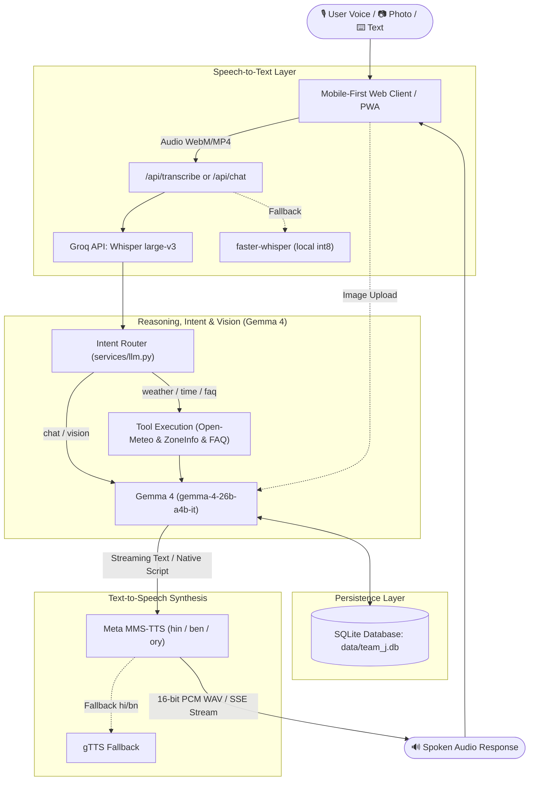

# BhashaSandhi (भाषासंधि / ভাষাসন্ধি / ଭାଷାସନ୍ଧି)

> **High-speed, end-to-end open-weight multilingual voice assistant for Indic languages (Hindi, Bengali, and Odia) with real-time streaming, multimodal vision, and tool execution.**

[](LICENSE)
[](DEPLOY.md)
[](https://huggingface.co/openai/whisper-large-v3)
[-blue)](https://ai.google.dev/gemma)
[](https://huggingface.co/facebook/mms-tts-hin)

---

## 🌐 Live Demo & Deployment

- **Live URL:** `https://bhashasandhi-hack4haldia.ondigitalocean.app` *(Replace with deployed URL)*
- **Health Check:** `GET /health`
- **Target Prizes:**
  1. 🏆 **Best Open-Source AI Project** (DigitalOcean / MLH + DEV)
  2. 🌟 **Best Use of Gemma 4** (Gemma 4 via Gemini API with Multimodal Vision & Streaming)

*(Note: The legacy Node starter `script.js` and `package.json` have been removed in favor of a clean, single-worker production Flask backend.)*

---

## 📖 What It Does

**BhashaSandhi** bridges the linguistic divide across eastern and northern India by providing a conversational voice assistant that speaks and listens natively in **Hindi**, **Bengali**, and **Odia**. Users can speak naturally into their phone or browser, query live weather in Haldia, ask for current time, consult a grounded FAQ knowledge base, attach photographs for instant visual explanations, or interact via text fallback.

---

## 🏗️ Architecture Diagram



---

## 🤖 Open-Source / Open-Weight Models Used

Every core step in the BhashaSandhi pipeline uses an open-weight model:

| Role | Model | Parameters / Size | License | Where it Runs |
| :--- | :--- | :--- | :--- | :--- |
| **Speech to Text (STT)** | [Whisper large-v3](https://huggingface.co/openai/whisper-large-v3) | 1,550 Million | [MIT License](https://github.com/openai/whisper/blob/main/LICENSE) | Hosted open weights on Groq Cloud; fallback local [faster-whisper](https://github.com/SYSTRAN/faster-whisper) (Apache 2.0) |
| **Understanding, Intent, Vision & Reply** | [Gemma 4](https://ai.google.dev/gemma) (`gemma-4-26b-a4b-it`, fallback `gemma-4-31b-it`) | 26 Billion / 31 Billion | [Gemma Terms of Use](https://ai.google.dev/gemma/terms) (Open-Weight Commercial/Research) | Google Gemini API with `google-genai` SDK |
| **Text to Speech (TTS - Hindi)** | [facebook/mms-tts-hin](https://huggingface.co/facebook/mms-tts-hin) | ~150 Million (VITS) | [CC-BY-NC 4.0](https://huggingface.co/facebook/mms-tts-hin) | Local container CPU via PyTorch / Hugging Face Transformers |
| **Text to Speech (TTS - Bengali)** | [facebook/mms-tts-ben](https://huggingface.co/facebook/mms-tts-ben) | ~150 Million (VITS) | [CC-BY-NC 4.0](https://huggingface.co/facebook/mms-tts-ben) | Local container CPU via PyTorch / Hugging Face Transformers |
| **Text to Speech (TTS - Odia)** | [facebook/mms-tts-ory](https://huggingface.co/facebook/mms-tts-ory) | ~150 Million (VITS) | [CC-BY-NC 4.0](https://huggingface.co/facebook/mms-tts-ory) | Local container CPU via PyTorch / Hugging Face Transformers |

---

## 🌟 Gemma 4 Prize: How We Use Gemma 4 Through Gemini API

All intelligence, multilingual translation, tool-grounding, intent routing, and vision understanding are handled by **Gemma 4** through the official `google-genai` SDK (`from google import genai`):

1. **Strict Spoken-Style System Prompting**: Located in [`services/llm.py`](services/llm.py#L60). Gemma is constrained to output 1-3 spoken-style sentences in the target Indic script with zero markdown or emojis, preventing the downstream TTS engine from vocalizing punctuation noise.
2. **Dynamic Model Discovery & Fallback**: At startup in [`services/llm.py`](services/llm.py#L38), the assistant queries `client.models.list()`, logs available models, and falls back gracefully from `gemma-4-26b-a4b-it` to `gemma-4-31b-it`.
3. **Structured Intent Routing**: Handled in [`services/llm.py:route_intent()`](services/llm.py#L125). Gemma extracts JSON intents (`time`, `weather`, `faq`, `chat`) and city arguments defensively.
4. **Direct Indic Translation**: Located in [`services/llm.py:translate()`](services/llm.py#L82) for zero-shot text translation without meta-commentary.
5. **Multimodal Vision Understanding**: Handled in [`services/llm.py:reply()`](services/llm.py#L175). Uploaded images are resized to 1024px JPEG and passed as native image parts to Gemma 4, allowing users to ask questions about photos in Hindi or Bengali.
6. **Real-time SSE Token Streaming**: Handled in [`services/llm.py:reply_stream()`](services/llm.py#L225) using `client.models.generate_content_stream`.

---

## 🇮🇳 Language Support Matrix

We believe in complete honesty about model capabilities:

| Language | ISO Code | Voice Input (STT) | Text Input | Voice Output (TTS) | Technical Notes |
| :--- | :---: | :---: | :---: | :---: | :--- |
| **Hindi** | `hi` | ✅ Yes | ✅ Yes | ✅ Yes | Full pipeline with Whisper large-v3 + Meta MMS-TTS Hindi |
| **Bengali** | `bn` | ✅ Yes | ✅ Yes | ✅ Yes | Full pipeline with Whisper large-v3 + Meta MMS-TTS Bengali |
| **Odia** | `or` | ⚠️ Best-effort | ✅ **Yes** | ✅ **Yes** | **Honest disclosure:** Whisper has no official Odia model. Odia text input is natively answered and spoken aloud via `facebook/mms-tts-ory`. |
| **English** | `en` | ✅ Yes | ✅ Yes | ✅ Yes | Universal fallback for testing and debugging |

---

## ✅ Feature Checklist

- [x] **Single-turn & Multi-turn Voice Pipeline**: Speak in Hindi/Bengali &rarr; receive audio speech reply in the same language.
- [x] **Language Auto-Detection**: Automatically identifies language from speech (Whisper) or Unicode script heuristics (Devanagari, Bengali, Odia).
- [x] **Visual Pipeline Stepper**: Live UI indicator tracking `Listen` &rarr; `Whisper` &rarr; `Gemma 4` &rarr; `MMS-TTS`.
- [x] **Gemma 4 Multimodal Vision**: Take or attach a picture and query it in Hindi or Bengali.
- [x] **Server-Sent Events (SSE) Streaming**: Low-latency token-by-token streaming in chat bubbles.
- [x] **Grounded Tools**:
  - Live weather forecast via Open-Meteo (default Haldia, no API key needed).
  - Indian Standard Time (IST Asia/Kolkata) via `zoneinfo`.
  - Grounded FAQ knowledge base (`faq.json`).
- [x] **Real SQLite Persistence**: `turns` table tracking session history, feeding last 6 turns to LLM.
- [x] **Offline Resilience**: Progressive Web App with Service Worker (`static/sw.js`) and browser `speechSynthesis` fallback.
- [x] **Production Hardening**: In-memory token bucket rate limiting per IP, 10MB audio size cap, temp file lifecycle cleanup.

---

## 🚀 Running Locally

### 1. Clone & Set Up Virtual Environment
```bash
git clone https://github.com/Debarun1205/BhashaSandhi.git
cd BhashaSandhi

python -m venv venv
# Linux / macOS:
source venv/bin/activate
# Windows:
.\venv\Scripts\activate
```

### 2. Install Dependencies
```bash
pip install -r requirements.txt
```

### 3. Configure `.env`
```bash
cp .env.example .env
# Edit .env and insert your GEMINI_API_KEY and GROQ_API_KEY
```

### 4. Run the Server
```bash
python app.py
```
Open `http://localhost:8080` in your web browser.

---

## 🐳 Running with Docker

```bash
# Build Docker image (pre-caches MMS models)
docker build -t bhashasandhi .

# Run container on port 8080
docker run -p 8080:8080 --env-file .env bhashasandhi
```

---

## 🧪 Testing

We provide full smoke tests and an automated round-trip voice test:

```bash
# Run pytest smoke tests
pytest tests/test_api.py -v

# Run the automated STT <-> TTS agreement roundtrip test (no human voice needed)
python tests/roundtrip.py
```

---

## 📡 API Reference

| Method | Endpoint | Request Payload | Response |
| :--- | :--- | :--- | :--- |
| `GET` | `/health` | None | `{"status": "ok", "project": "BhashaSandhi", "stack": "flask", ...}` |
| `GET` | `/api/languages` | None | Array of `{code, name, native, stt: bool, tts: bool}` |
| `POST` | `/api/transcribe` | Multipart: `audio` (file), optional `language` | `{"text": "...", "language": "hi", "backend": "groq", "duration_ms": 140}` |
| `POST` | `/api/translate` | JSON: `{"text": "...", "target": "hi", "source": "en"}` | `{"text": "...", "source": "en", "target": "hi"}` |
| `POST` | `/api/speak` | JSON: `{"text": "...", "lang": "hi"}` | Binary `audio/wav` with `X-TTS-Backend` header |
| `POST` | `/api/chat` | Multipart: `audio` or `text`, optional `image`, `lang`, `session_id` | JSON with transcript, reply text, base64 audio, and timing breakdown |
| `POST` | `/api/chat/stream` | Multipart: same as `/api/chat` | Server-Sent Events: `transcript`, `token`, `audio`, `done` |
| `GET` | `/api/history` | Query params: `session_id`, `limit` | Last N turns from SQLite |

---

## ⚠️ Known Limitations & Future Work

1. **Odia ASR**: Whisper does not officially support Odia speech recognition. We support Odia text input and provide high-fidelity Odia voice synthesis via `facebook/mms-tts-ory`. Future work includes fine-tuning Whisper on the Odia Mozilla Common Voice dataset.
2. **Model Footprint on Free Clouds**: Meta MMS-TTS models require ~1.5 GB RAM. While lightweight compared to cloud LLMs, deployment requires at least a 2 GB RAM node.
3. **Database Ephemerality**: SQLite database resets on ephemeral container hosts (DigitalOcean App Platform redeploys). Production migration would target managed PostgreSQL or persistent volumes.

---

## 👥 Team Members & Credits

- **Team Name:** Team J
- **Hackathon:** Hack4Haldia'26
- **License:** [MIT License](LICENSE)

*Acknowledgements: Thanks to DigitalOcean, Google DeepMind (Gemma), Meta AI (MMS), and OpenAI (Whisper) for open-access AI weights.*
# BhashaSakti-

# BhashaSakti-

